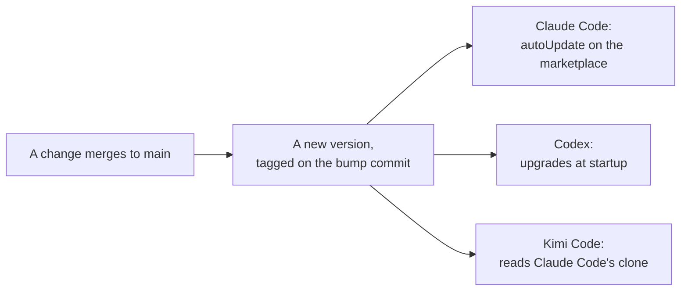
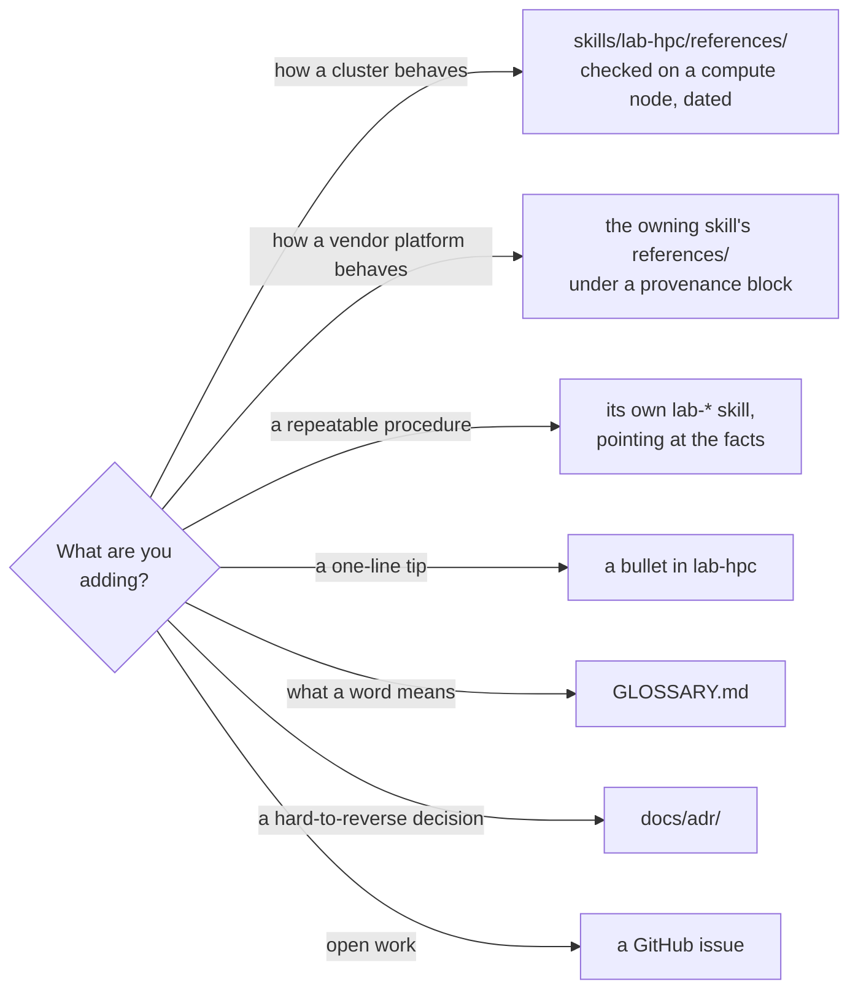
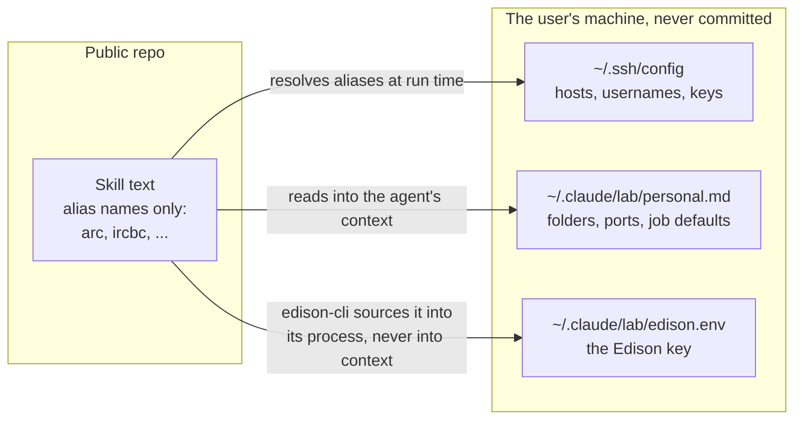
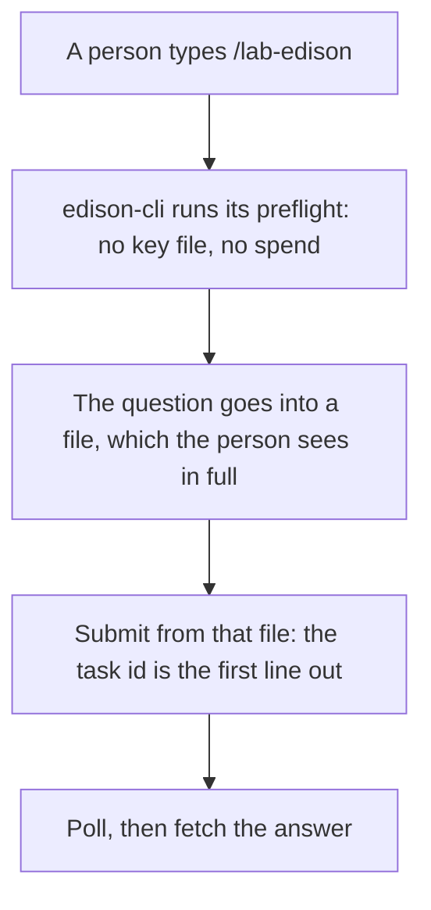

# Design choices

The choices below shape most changes to this repo. Each one names what it costs, and links
the decision record that argues it in full. The records live under `docs/adr/`. A choice
that was later reversed links the record that reversed it.

## One plugin, updated as a whole

Every skill ships in one plugin, `lab`, from one marketplace, `liulab`. The skills lean on
each other: `lab-jupyter` takes a job line word for word from `lab-containers`, and both
defer to `lab-hpc` for the safety rules. A machine running two skills at two different
versions is a mix nobody tests. That mix fails as a wrong command on a real cluster, which is
the worst place to find out.

One plugin makes an update all or nothing. The cost is that a lab member who wants one skill
installs all of them, and every skill's description takes a little of every agent's context.
That pressure is why descriptions stay short and dense with trigger words.

Read the record: [The repo root is the plugin, and one plugin holds every
skill](../adr/0001-repo-root-is-the-plugin.md).

## A version names one tree

Every change merged to `main` bumps the version, even a change to a test or a comment. The
whole tree ships, so two different trees must never answer to one number. `tests/lint.sh`
fails a tagged version whose files have moved since the tag.

Versions are calendar dates, `YEAR.MONTH.PATCH`. What ships is prose an agent reads, with no
API to break, so the only thing a version needs to say is how old a copy is.

Installed copies update on their own. Releasing is pushing, and a fixed safety rule reaches
every machine at its next launch. So does a bad release, with nobody choosing to take it.

Read the records: [The version names one tree](../adr/0008-version-identifies-the-content.md),
[CalVer](../adr/0004-calver-and-manual-updates.md), and [Installed copies update on their
own](../adr/0014-installed-copies-update-on-their-own.md), which reversed the manual-update
half of the CalVer record.

## Facts and procedures live apart

New content goes where its kind says, not where the person asking for it happens to work.

A fact copied into two skills goes stale in one of them, and no check can tell which copy is
right. On a cluster that is not a stale sentence. It is an agent typing `squeue --me` on a
Slurm version that lacks it.

Two rules keep facts honest:

- **Record configuration, never measurements.** Configuration is what an agent must type: a
  partition's time limit, a port, a module name. A measurement is free disk space, a queue
  wait or a node count. It is true for one afternoon, and the agent cannot tell when it went
  stale. Write the guidance and the command that gives a live value instead: "`/large_storage`
  fills up, check `df -h`", not "81% used".
- **Facts carry their source.** A vendor fact cannot be checked again for free, so each
  `lab-edison` reference page opens with a provenance block. The block gives its source, the
  date it was checked, and one of three tiers. *Verified* means we ran it. *Read* means it
  came from the package source or a vendor page. *Unverified* means it was inferred. Lint
  fails a page without one.

Read the records: [Facts versus recipes](../adr/0002-facts-vs-recipes.md), [Jupyter and
containers split at the job line](../adr/0003-jupyter-containers-ownership-split.md), and
[Facts carry their provenance](../adr/0009-facts-carry-their-provenance.md).

## No secrets, by construction

The repo is public, so it holds no connection details at all. Skills name hosts only by the
lab's ssh alias names, and read everything else from the user's machine when they run.

`tests/lint.sh` sweeps every file for a leaked address, hostname or username. It reads your
own ssh config to know which names to look for, so the sweep is complete only on a machine
with the lab's ssh aliases. CI cannot run it in full, which is why you run the gate before you push.

The Edison key gets a file of its own because `personal.md` is read into the agent's
context. That is its job. A key written there would land in the transcript of every session.
The key file is sourced by a shell instead, so the key reaches the client without ever
appearing as text.

Read the record: [The Edison key gets its own file](../adr/0007-edison-key-file-and-never-transmit.md).

## Rules become structure

A rule an agent must remember at the moment it matters fails sooner or later. Where a rule
guards something costly, the repo turns it into something that runs.

- **Preflights refuse.** `lab-hpc` checks the machine's ssh setup before any cluster work, and
  refuses on a machine that is not set up rather than asking for an address.
- **Spending goes through a command.** `lab-edison` once taught an agent to submit a task,
  print its id, and only then poll. A real session lost a paid run's id anyway, and it had to
  be dug out of the task history. Now `edison-cli` does it in order:

- **Lint checks the conventions.** Names, version tags, eval case lists and the no-secrets
  sweep are all checks in `tests/lint.sh`, not reminders in a document.
- **Some steps always wait for a person.** `hq-mode`'s always-pause list, such as submitting
  a Slurm job or merging an unreviewed pull request, outranks anything said in the session,
  "land it" included.

Read the records: [The Edison skill ships its spend path](../adr/0010-edison-skill-runs-through-a-script.md)
and [The spend path became a package](../adr/0011-the-spend-path-became-a-package.md).

## Two kinds of page

Every page is written either for an agent that has to act, or for a person reading this site.
The gate checks each kind for different things.

| | For agents | For people |
| --- | --- | --- |
| Files | `AGENTS.md`, every `SKILL.md` and `references/` page, `docs/adr/`, `docs/agents/` | `README.md`, `CHANGELOG.md`, the pages in this site's menu |
| Checked for | A word cap for each kind of file | No jargon from the lab's list, and a reading grade of 11 or below |
| On this site | Out of the menu and search, still reachable by URL | In the menu and search |

A cap that fires means the text belongs somewhere else, such as a `references/` page, not that
the cap should rise. Upstream text in an adopted skill is exempt, so it passes unchanged. `docs/agents/writing.md` has the caps
and how to measure against them.

## Upstream skills keep upstream text

The lab takes general engineering skills from mattpocock/skills and pstack instead of writing
its own. A tracked skill only ever gains text, and keeps its upstream name, so each sync
merges cleanly. [Skills from mattpocock and pstack](upstreams.md) has the whole story.

## The docs site runs on an alpha

This site is built by zensical, an early `0.0.x` builder from the makers of Material for
MkDocs. The lab wants every repo on one builder, and this repo is the cheapest place to try
it: a few hand-written pages, nothing generated. The pin is exact, and moving back to mkdocs
is a short change to `pyproject.toml` and `mkdocs.yml`.

Read the record: [The docs site is built by zensical](../adr/0005-docs-site-on-zensical.md).
