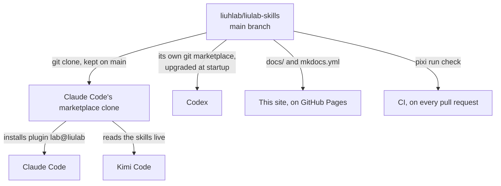
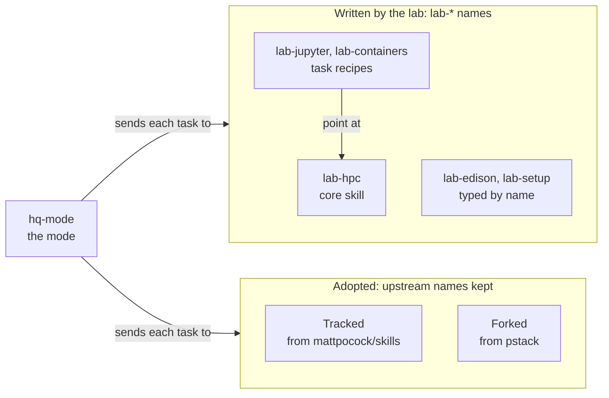
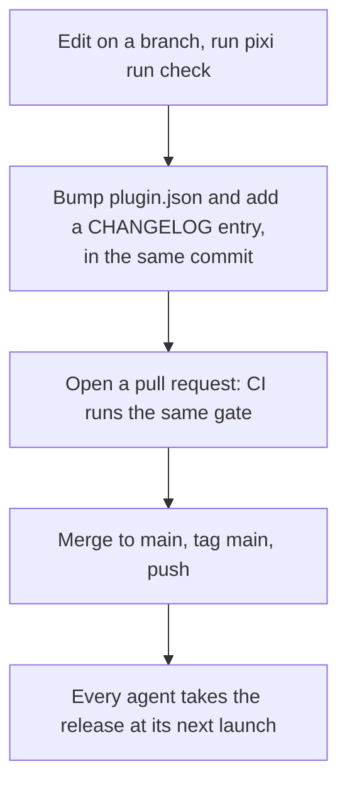
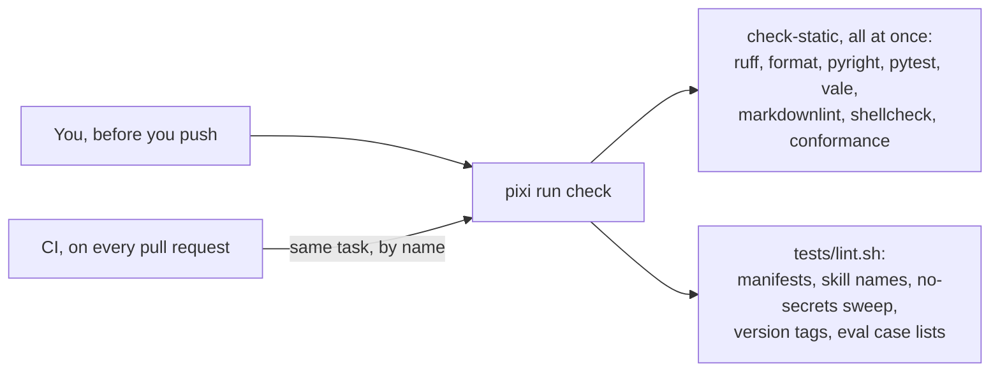

# How the repo is organized

This section is for people who change the repo. The skill pages above are for people who use
it. An agent working on the repo reads `AGENTS.md` instead. These pages explain the same rules
for people.

## One tree, read by every agent

The repo root is the plugin. `.claude-plugin/marketplace.json` declares `source: "./"`, so
what you clone and what a lab member installs are the same files. Each agent tool reaches
them by its own path:



Because the whole tree ships, nothing in it is private to developers. Tests, styles and these
pages all land on every lab machine. That is why the repo's [security rule](#the-rules-that-hold-everywhere)
covers every file, not only the skills.

## Where things live

```text
liulab-skills/
├── .claude-plugin/       marketplace.json and plugin.json, which holds the version
├── skills/<name>/        one folder per skill: SKILL.md, references/, scripts/
├── src/edison_cli/       the Python package lab-edison spends credits through
├── bin/edison-cli        the command that runs it
├── upstream/             pins, attribution records and licenses for adopted skills
├── templates/            files a lab member copies to their own machine
├── tests/                lint.sh, preflight.sh, eval.sh and the pytest suite
├── scripts/              check.sh, conformance.py, upstream_sync.py
├── styles/Lab/           vale rules: word caps, jargon, reading grade
├── docs/                 this site, plus the unlisted adr/ and agents/ pages
├── .claude/commands/     the maintainer's upstream sync command
├── AGENTS.md             how an agent works on the repo (CLAUDE.md is a symlink to it)
├── GLOSSARY.md           the repo's words, one entry each
└── CHANGELOG.md          one entry per version
```

Two folders under `docs/` hold pages for agents: `docs/adr/` keeps the decision records, and
`docs/agents/` keeps the working rules. Both are built and reachable by URL, but they stay
out of the menu and out of search.

## Kinds of skill

Every skill sits in one of a few kinds. The kind decides its name, who owns its text, and how
it changes.



- **The core skill**, `lab-hpc`, holds what is true about the clusters. Every other cluster
  skill points at it and never repeats it.
- **Task recipes** hold one procedure each. `lab-jupyter` owns a Jupyter session from start
  to cleanup. `lab-containers` owns every command that runs inside a container, including the
  one `lab-jupyter` borrows on ircbc.
- **Typed-by-name skills** never load on their own. `lab-edison` spends money and `lab-setup`
  changes a machine, so a person starts each one.
- **The mode**, `hq-mode`, is a router. It picks a playbook for the task and sends the agent
  to the right skill at each step.
- **Adopted skills** come from two outside projects. [Upstream skills](upstreams.md) explains
  how each one arrives and changes.

The README's "Adding a new skill" section has the steps for a new one.

## How a change ships

Every merged change is a release, even one that only touches a test.



Versions are calendar dates, `YEAR.MONTH.PATCH`, such as `2026.7.0`. [Design
choices](design.md#a-version-names-one-tree) says why every change bumps one.

## Checking a change

`pixi run check` is the one command that must pass. It starts every check at once and reports
every failure in a single run, so read the output to the bottom.



The list of steps lives in one place, the `check-static` task in `pyproject.toml`. CI calls
that task by name, so your machine and CI cannot drift apart. To add a check, add it there.

Two more checks run only on your own machine, never in CI. `tests/preflight.sh` reads your
real ssh config. `tests/eval.sh` runs a full agent session per case and costs tokens, so run
one case with `--only` when a change to a skill's behavior needs proof.

## The rules that hold everywhere

- **No connection details, ever.** No addresses, hostnames, usernames, key names or
  passwords, in any file. Hosts appear only as the lab's ssh alias names. `tests/lint.sh`
  sweeps for leaks, using your own ssh config to know what to look for, so run the gate
  before you push.
- **Nothing runs on a cluster without a person's yes.** A skill shows the exact job script and
  waits.
- **Agent text has word caps, and people's text has a reading grade.** [Design
  choices](design.md#two-kinds-of-page) explains the split.
