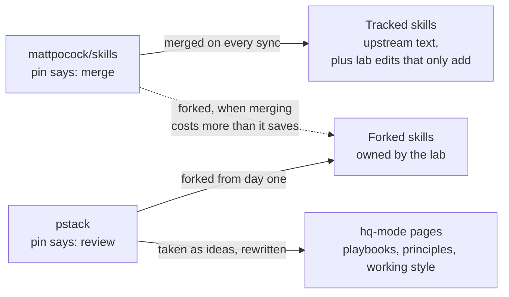
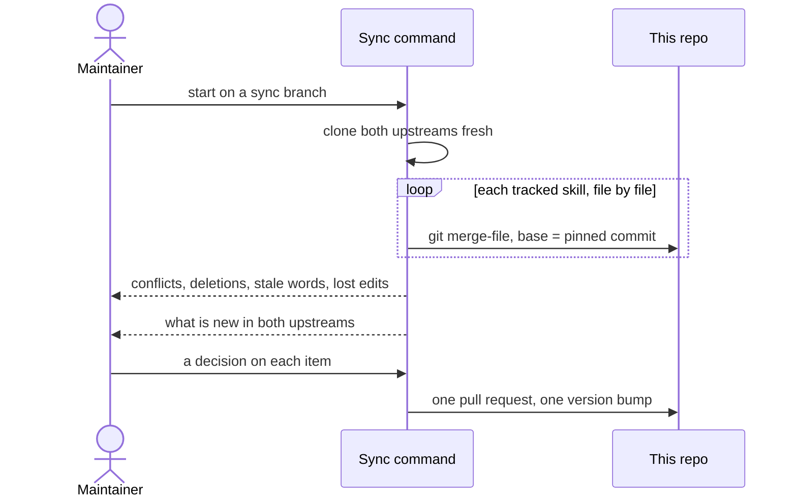
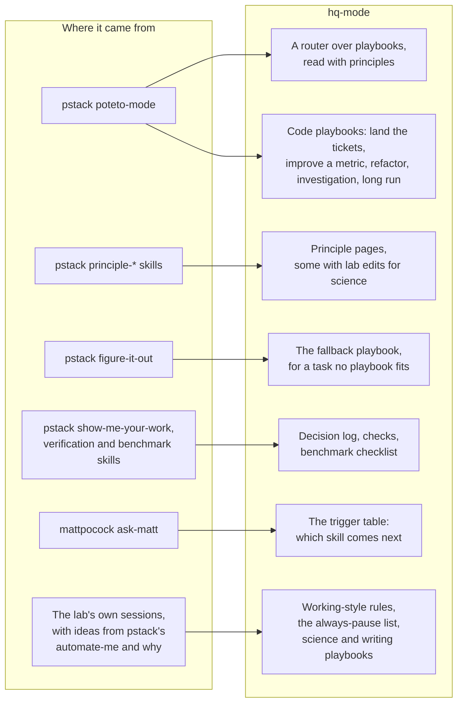
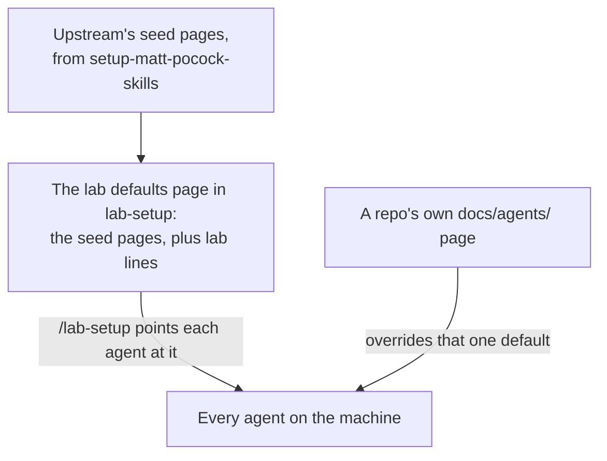

# Skills from mattpocock and pstack

The lab writes the skills that know about its clusters and its platforms. The general
engineering skills, for planning, building, reviewing and writing, come from two outside
projects:

- [mattpocock/skills](https://github.com/mattpocock/skills), a set of agent skills for
  planning and building software, such as `grilling`, `to-spec`, `tdd` and `code-review`.
- [pstack](https://github.com/cursor/plugins/tree/main/pstack), a skill pack in
  cursor/plugins. Its `poteto-mode` and its principles shaped `hq-mode`, and four of its
  skills ship here: `unslop`, `technical-writing`, `ketchup` and `bro`.

Both are MIT licensed. Their licenses sit in `upstream/<project>/LICENSE`.

## Two projects, two ways in

The lab follows both projects, but takes text from each in a different way.



Each project has a pin in `upstream/<project>/pin.json`: the commit last synced and a map
from each upstream item to the lab file it feeds. Every forked item, including each `hq-mode`
page built from pstack, also gets a record in `upstream/attribution.json`.

**mattpocock is merged.** Its skills arrive as written, and the lab only ever adds to them.
Each sync merges upstream's new text into the lab's copy, so an upstream fix reaches the lab
at the next sync.

**pstack is only reviewed.** Nothing the lab takes from it arrives unchanged: its principles
became pages inside `hq-mode`, and its other items lose text written for Cursor. Most of
its churn trims words for the models Cursor runs. The lab runs other agents on other models,
so a sync lists what changed in pstack and a person decides what to port by hand.

## Tracked, forked and derived

| Kind | Who owns the text | How upstream changes arrive | Name |
| --- | --- | --- | --- |
| Tracked | Upstream, plus lab edits that only add | Merged by each sync | Upstream's own |
| Forked | The lab | As ideas in the sync's summary, ported by hand | Upstream's own |
| Derived | The lab, from the start | As ideas only | `lab-*`, or `hq-mode` |

Every mattpocock skill starts tracked. The maintainer forks one when merging it costs more
than it saves, by judgement and not by a fixed threshold. Every pstack item is forked.

To see which skills are tracked, read the pin's `items` map:

```bash
python3 -c 'import json; print(*json.load(open("upstream/mattpocock/pin.json"))["items"], sep="\n")'
```

## Adding to a tracked skill

A lab edit may add to a tracked skill and may never remove a line of upstream's text. That
rule is what lets the next sync merge cleanly. It has two forms:

- A short branch or a loop path goes in place, in the upstream file.
- A whole new section goes in a side page beside it, named `<topic>.lab.md`, with a one-line
  pointer from the upstream file. For example, `skills/code-review/science-smells.lab.md`
  adds the defects that change an analysis result, such as an unseeded random split.

A safety rule is never a lab edit. It goes on `hq-mode`'s always-pause list or into a
lab-owned skill, where no upstream change can reword it.

## How a sync runs

The maintainer runs `/lab-upstream-sync` by hand, about once a month. It lives in
`.claude/commands/`, so plugin users never see it.



The repo stores no copy of upstream, only the pin, and the pull request moves each pin
forward. The merge finds a skill by its frontmatter
`name`, so upstream can move a skill between folders at no cost. A deleted upstream skill
shows up in the report instead of vanishing.

## Names stay as upstream wrote them

An adopted skill keeps its upstream name, typed bare: `/grilling`, not `/lab-grilling`.
Upstream skills name each other in their text. `wayfinder` names `grilling`, `research` and
`prototype`, so a rename would have to be redone on every sync. A `lab-*` name therefore
marks a skill the lab wrote. `tests/lint.sh` fails any other name unless `upstream/` records
it, with `hq-mode` the one exception.

The cost is shadowing. A bare name reaches whichever skill holds it, so an old copy of
`grilling` in a user's own skills folder wins over the plugin's without a word.
`/lab-setup` lists such copies and removes none.

## What hq-mode took from each

`hq-mode` is the lab's own skill, but most of its shape is borrowed.



In pstack each principle is its own skill. Here each is a page that `hq-mode` reads by path
when the principle applies. The science edits are small and named. For example, before an
agent trusts a result number, it rules out data leaking between splits, batch effects,
repeated samples, and a filter that changed what the number is out of.

## The lab defaults reuse upstream's setup pages

mattpocock's planning skills expect three things to be "provided to you": an issue tracker,
triage labels and a place for domain docs. Upstream's `setup-matt-pocock-skills` writes these
into each repo. The lab provides them once per machine instead.



The defaults page links upstream's pages as written and adds the lab's lines, among them the
GitHub issue rules for a public repo, the cluster rules that hold in every session, and the
line that turns on `hq-mode`'s working style. A repo that differs keeps its own page under
`docs/agents/`, and runs `/setup-matt-pocock-skills` only for that.
